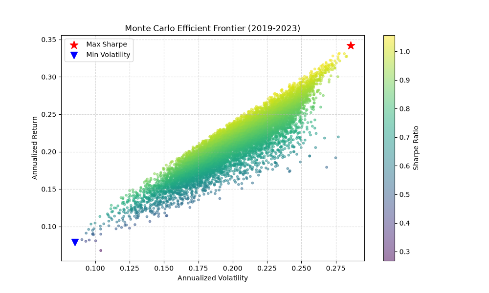

# Portfolio Optimization (Monte Carlo)

Simulates 10,000 random long-only portfolios across five assets to find the **maximum Sharpe ratio** and **minimum volatility** allocations, then plots the efficient frontier.



## What it does

1. Downloads daily closing prices for AAPL, MSFT, JPM, VOO (S&P 500 ETF) and IEF (7–10 year Treasury ETF) from 2019 to 2023 with `yfinance`.
2. Computes daily returns, mean returns and the covariance matrix in Pandas.
3. Generates 10,000 random weight vectors (summing to 1) and, for each, calculates annualized return, volatility and Sharpe ratio:

$$R_p = 252 \cdot \sum_i w_i \mu_i \qquad \sigma_p = \sqrt{252 \cdot w^\top \Sigma w} \qquad \text{Sharpe} = \frac{R_p - r_f}{\sigma_p}$$

4. Picks out the max-Sharpe and min-volatility portfolios and prints their allocations.

## Result

The max-Sharpe portfolio reached a Sharpe ratio of about **1.05** (assuming $r_f = 4\%$). Run the script to see the full allocation.

## Run it

```bash
pip install -r requirements.txt
python main.py
```

## Limitations and next steps

- Random sampling only approximates the frontier; a solver like `scipy.optimize` would find the exact optimum.
- Uses historical mean returns, which are a noisy estimate of future returns.
- Next: add a train/test split to check how the optimal weights hold up out of sample.
